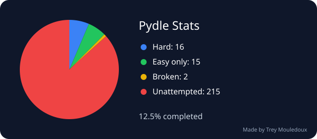

# Pydle Stats

My attempts at [Pydle](https://pydle.net), one Python puzzle at a time 🐍

<!-- pydle-progress:start -->
**26 / 247 games completed** · **10.5%** · **28 attempted**

**12 hard** · **14 easy only** · **2 broken** · **219 unattempted**

**Average score: 131.9 characters** across completed games

**Best score:** 79 characters / [#87 Fries.py](games/%2387%20Fries.py)


<!-- pydle-progress:end -->

All my attempts are in [`games/`](games). Each filename starts with its game number, like `#73 Frog.py`.

Progress updates automatically on every push to the default branch and every day through GitHub Actions. The Action generates `assets/pydle-progress.svg` and commits it with the updated README.

The shortest saved attempt determines each game's result: **Hard** is under 125 characters; **Easy only** is 125–249; **Broken** tracks broken attempts separately. **Unattempted** includes unattempted games, scores of 250 or more, and attempts without a recorded score. Hard also beats easy, but each game occupies just one pie slice. Hard is blue, easy green, broken yellow, and unattempted red. Attempt results come entirely from the repo; the website supplies only the total number of games.

Scores come from the Pydle character counts recorded in comment headers, like `#Final Solution 123 / 250 chars`, paired with the code below them. Every scored attempt section is checked, and the lowest saved score per game is used. Empty attempt sections are ignored. The average uses one best score per completed game, excluding broken and unattempted games. Attempts without a recorded score count as unattempted until a score is added. This tracks saved scores; it doesn't run solutions or validate their output against Pydle.

To refresh manually, run **Update Pydle progress** from the Actions tab. If needed, set the repository variable `PYDLE_ARCHIVE_URL` to the archive's URL; otherwise the updater opens the archive from the homepage.

For a local refresh:

```sh
python -m pip install playwright==1.58.0
python -m playwright install chromium
python scripts/update_progress.py
```

If the archive can't be read, the workflow fails and keeps the previous progress display.

> [!NOTE]
> The stats calculator and this README are AI-assisted. All Python puzzle attempts in `games/` are written by me.
